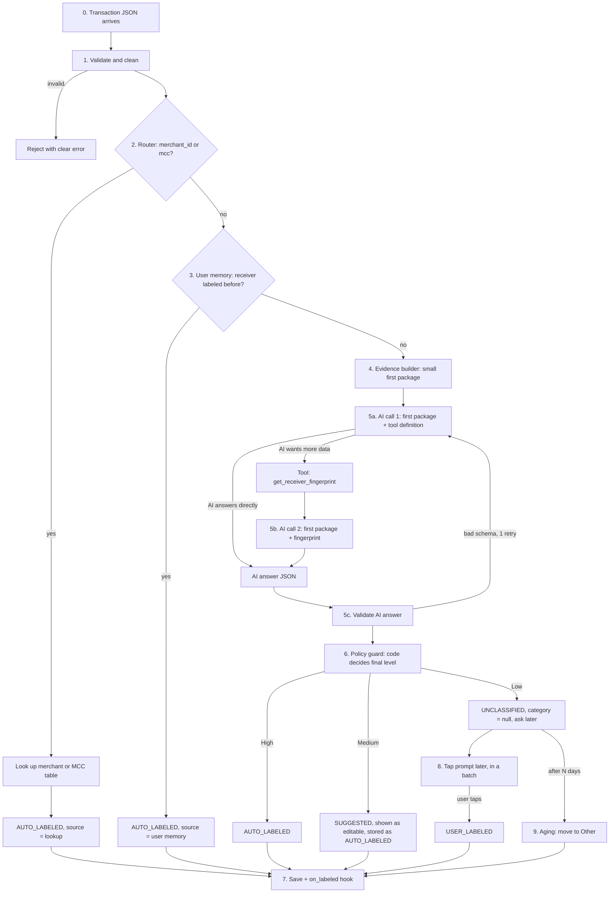
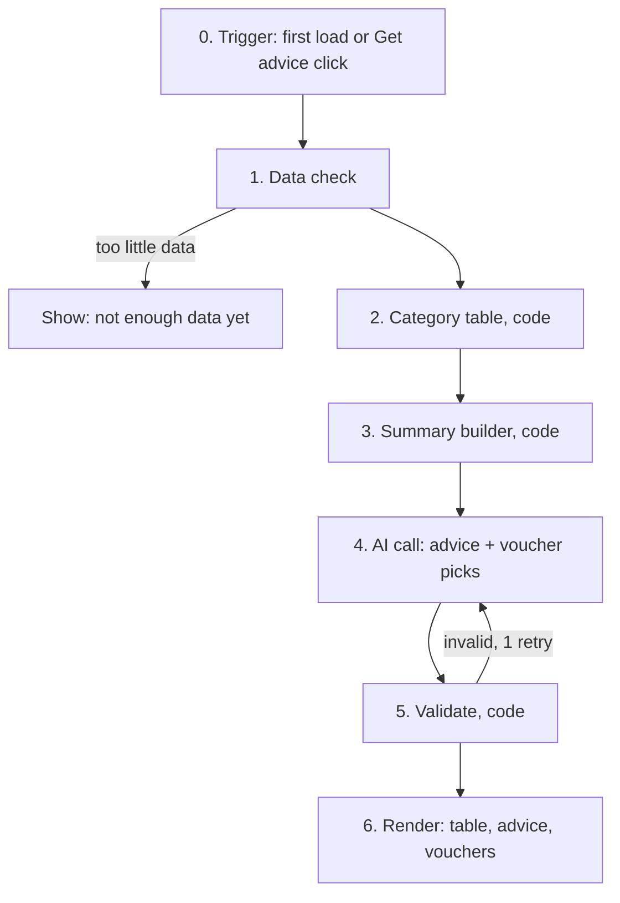

# MoMo Auto Spending Categorization: Workflow Draft

Status: draft, Nov 26, 2026. Companion to `agent_context.md`, `agent_io_spec.md` and `architecture.md`. All data is simulated.

Items marked **[Confirm]** are my suggestions that your teammate has not approved yet.

---

## 0. Decisions this workflow is built on

| # | Decision | Where it matters |
|---|---|---|
| 1 | The AI step is a small loop: the AI can call a tool (`get_receiver_fingerprint`) before it answers | Flow 1, step 5 |
| 2 | The AI gets a **small first package**. The detailed receiver pattern is fetched only when the AI asks | Flow 1, steps 4 and 5 |
| 3 | **AI is the core.** Without AI the product does not work | Run modes, failure handling |
| 4 | No AI = recorded answers for the 4 seeded scenarios only. Custom transactions show "AI required". No rules-based fallback labels | Run modes |
| 5 | The demo user starts with about 30 to 50 fake, already-labeled transactions (one month). New ones are added one by one | Both flows |
| 6 | Advice runs once on first load, then only when the user clicks "Get advice" | Flow 2 |
| 7 | The AI picks 2 to 3 vouchers by ID from a fixed mock list. Code rejects any ID not on the list | Flow 2 |
| 8 | New field: the user's monthly income | Flow 2 |

---

## 1. The product on one screen

```
+--------------------------------------------------+
| Recent transactions (with category + status)     |
+--------------------------------------------------+
| Spend-by-category table (+ monthly income)       |
+--------------------------------------------------+
| AI advice: what to spend less on, how to manage  |
+--------------------------------------------------+
| Suggested vouchers                               |
+--------------------------------------------------+
| Side panel: evidence, tool calls, reason         |
| Simulator: 4 scenario buttons + custom form      |
+--------------------------------------------------+
```

Two separate flows feed this screen:

- **Flow 1: Label a transaction.** Runs every time a transaction arrives.
- **Flow 2: Advice and vouchers.** Runs on first load and when the user clicks "Get advice".

The link between them is the `on_labeled` hook: once a transaction has a label, it counts in the category table.

---

## 2. Flow 1: Label a transaction

### 2.1 Diagram



### 2.2 Step table

| # | Step | Done by | Input | Output | If it fails |
|---|---|---|---|---|---|
| 0 | Receive | API: `POST /transactions` | JSON from a scenario button or the custom form | Raw transaction | Reject with error |
| 1 | Validate and clean | Code | Raw transaction | Clean transaction. Sender name removed from `transfer_message` | Missing amount, time or receiver: reject |
| 2 | Router | Code | `merchant_id`, `mcc` | Category from the merchant or MCC table, or "no match" | No match: go to step 3 |
| 3 | User memory | Code | `receiver_id` + user | Saved category or "none" | None: go to step 4 |
| 4 | Evidence builder (small package) | Code | Clean transaction + user history | Small first package (see 2.3) | Missing history: send `null` fields |
| 5a | AI call 1 | **AI** | Small package + tool definition | Either a final answer, or a request to call the tool | Timeout: retry once, then see 2.6 |
| 5b | Tool call | Code runs it for the AI | `receiver_id` | Receiver fingerprint, aggregates only (see 2.4) | No crowd data: `distinct_senders = 0` |
| 5b | AI call 2 | **AI** | Small package + fingerprint | Final answer | Same as 5a |
| 5c | Validate AI answer | Code | AI JSON | Valid answer | Bad schema or category not in `allowed_categories`: retry once, then see 2.6 |
| 6 | Policy guard | Code | AI answer + crowd numbers | Final level and action | Not applicable |
| 7 | Save and hook | Code | Labeled transaction | Row saved, `on_labeled` fired, side panel updated | Clear error |
| 8 | Tap prompt | UI + code | Unclassified items, sorted by receivers with most senders | `USER_LABELED`, saved to user memory | User can skip |
| 9 | Aging | Code (scheduled, with a demo "fast-forward" button) | Unclassified older than N days | Category = Other | Not applicable |

### 2.3 Example: the small first package (step 4 output)

This is what the AI sees first. The detailed receiver pattern is **not** in it.

```json
{
  "transaction": {
    "transaction_id": "TXN_20261125_000182",
    "amount": 45000,
    "channel": "VIETQR_P2P",
    "receiver_display_name": "NGUYEN THI HOA",
    "account_type_hint": "PERSONAL",
    "transfer_message_clean": "chuyen tien"
  },
  "time_features": { "hour": 12, "weekday": "Wednesday", "is_meal_window": true },
  "amount_features": { "vs_user_median": 0.9 },
  "name_clues": [],
  "user_context": { "top_categories_this_month": ["Food & Drink", "Shopping"] },
  "allowed_categories": [
    "Food & Drink", "Groceries & Market", "Transport", "Shopping",
    "Entertainment & Outdoor", "Bills & Utilities", "Housing & Rent",
    "Health & Education", "Personal transfer", "Other"
  ]
}
```

Changes from `agent_io_spec.md`:

- `crowd_evidence` and `vs_receiver_typical_range` are removed from the first package. They move into the tool result.
- `own_label_for_receiver` is dropped. It is always null at this step, because a saved user label exits at step 3. **[Confirm]**

### 2.4 The tool: `get_receiver_fingerprint`

The AI can call this tool only with a `receiver_id`. The id comes from our code, never from text inside the message or name (protection against prompt injection).

Tool result (aggregates only, never raw messages from other users):

```json
{
  "distinct_senders": 38,
  "label_distribution": { "Food & Drink": 0.71, "Shopping": 0.05, "Personal transfer": 0.24 },
  "typical_amount_range": [30000, 60000],
  "peak_hours": [11, 12, 18],
  "message_keywords": { "com": 14, "tra sua": 6, "cafe": 3 }
}
```

Rules for the loop:

- The AI may call the tool at most **once** per transaction.
- If the clues in the first package are already enough, the AI may answer without calling it.
- Every tool call is shown in the side panel ("AI asked for receiver pattern: 38 senders found").

### 2.5 Example: the AI answer (step 5c)

```json
{
  "transaction_id": "TXN_20261125_000182",
  "category": "Food & Drink",
  "confidence_score": 0.86,
  "reason": "38 senders paid this receiver and 71% labeled it Food & Drink. The amount and time fit a meal.",
  "clues_used": [
    { "clue": "crowd_labels", "detail": "71% Food & Drink across 38 senders", "weight": "strong" },
    { "clue": "time_and_amount", "detail": "Meal window, within typical range", "weight": "supporting" }
  ],
  "alternatives": [
    { "category": "Personal transfer", "score": 0.10 }
  ],
  "suggested_buttons": [],
  "used_tool": true
}
```

The AI proposes a category and a score. It does **not** set the final action. The guard does.

### 2.6 Step 6: Policy guard (code has the last word)

Draft values, to be tuned on the seeded data:

| Rule | Effect |
|---|---|
| Score 0.80 or above | Candidate for High |
| Score 0.50 to 0.79 | Medium: `SUGGESTED` |
| Score below 0.50 | Low: `UNCLASSIFIED`, category forced to `null` |
| `distinct_senders` below 15 | Cannot be High |
| Crowd agreement below 60% | Cannot be High |
| Conflicting crowd labels | Capped at Low |

**[Confirm] The guard reads the crowd numbers from the database itself**, not from the AI's answer. Reason: the AI may answer without calling the tool, but the guard still needs `distinct_senders` and agreement to apply its rules.

**When the AI is unavailable (decided):**

- Live mode, AI error or timeout after retry: the transaction stays pending and the UI shows "AI unavailable, try again". No label is guessed. **[Confirm]** exact wording and whether it uses `UNCLASSIFIED`.
- Replay mode: the 4 seeded scenarios show their recorded AI answers. Any custom transaction shows "AI required".

---

## 3. Flow 2: Advice and vouchers

### 3.1 Diagram



### 3.2 Step table

| # | Step | Done by | Input | Output | If it fails |
|---|---|---|---|---|---|
| 0 | Trigger | UI | First load, or the "Get advice" button | Request to `POST /advice` | Not applicable |
| 1 | Data check | Code | Labeled transactions this month, share of `UNCLASSIFIED` | Go or "not enough data yet" | Too few labeled transactions (N, to decide) or too many unclassified: show the message and no advice |
| 2 | Category table | Code | Labeled transactions this month, `monthly_income` | One row per category: total spent, share of spending, share of income, change vs last month | Unclassified items counted under Other, with a note "N unclassified" |
| 3 | Summary builder | Code | Category table + voucher list | Compact summary for the AI (see 3.3) | Not applicable |
| 4 | AI call | **AI** | Summary + voucher list | Advice and voucher picks (see 3.4) | Timeout: retry once, then "AI unavailable, try again" |
| 5 | Validate | Code | AI JSON | Valid answer | Retry once, else show the table without advice |
| 6 | Render | UI | Table + validated advice + vouchers | Screen blocks: table, advice, vouchers | Not applicable |

### 3.3 Example: summary sent to the AI (step 3 output)

```json
{
  "monthly_income": 8000000,
  "total_spent": 6200000,
  "categories": [
    { "category": "Food & Drink", "spent": 2100000, "share_of_income": 0.26, "change_vs_last_month": 0.18, "cuttable": true },
    { "category": "Transport", "spent": 700000, "share_of_income": 0.09, "change_vs_last_month": 0.02, "cuttable": true },
    { "category": "Housing & Rent", "spent": 2500000, "share_of_income": 0.31, "change_vs_last_month": 0.0, "cuttable": false }
  ],
  "unclassified_share": 0.05,
  "vouchers": [
    { "voucher_id": "V001", "category": "Food & Drink", "title": "20% off at a milk tea shop (mock)" },
    { "voucher_id": "V002", "category": "Transport", "title": "10k off a ride (mock)" }
  ]
}
```

**[Confirm]** Fixed-cost categories (Housing & Rent, Bills & Utilities, Health & Education) are marked `cuttable: false` by code, so the AI never tells someone to spend less on rent. All numbers above are made up.

### 3.4 Example: AI answer (step 4 output)

```json
{
  "cut_categories": ["Food & Drink"],
  "advice": "Food & Drink is your biggest flexible cost and rose 18% from last month. Try setting a weekly limit and cooking more at home.",
  "management_tips": [
    "Set a monthly budget per flexible category",
    "Check your spending once a week"
  ],
  "vouchers": [
    { "voucher_id": "V001", "why": "Helps you save in Food & Drink, your highest flexible category." }
  ]
}
```

### 3.5 Step 5: what code checks

| Check | Why |
|---|---|
| `cut_categories` are in the allowed list and `cuttable = true` | The AI cannot invent categories or target rent |
| Every number in the text matches the summary | The AI cannot make up figures |
| Every `voucher_id` exists in the voucher list | The AI cannot invent vouchers |
| At most 3 vouchers | Keeps the block short |

---

## 4. Data stored

| Store | Content | Used by |
|---|---|---|
| `users` | `user_id`, `monthly_income`, session id | Flow 2 |
| `transactions` | Clean transaction, category, state, source (lookup / memory / AI / user), confidence, AI answer JSON, tool-call log | Both flows, side panel |
| `merchants`, `mcc_table` | Mock lookup tables | Flow 1, step 2 |
| `user_memory` | `receiver_id` to saved category, per user | Flow 1, step 3 |
| `crowd_aggregates` | Per receiver: senders, label distribution, amounts, hours, keywords (seeded) | Tool and guard |
| `vouchers` | Mock list: id, category, title | Flow 2 |
| `recorded_answers` | Saved AI answers for the 4 seeded scenarios | Replay mode |

Each browser session gets its own copy of `users`, `transactions` and `user_memory`, with a Reset button.

---

## 5. Run modes

| Mode | Who | AI behavior |
|---|---|---|
| `live` | Hosted demo | Real AI. Key stays on the server, with rate limit and spend cap |
| `replay` | Judge running the zip with no key | Recorded AI answers for the 4 seeded scenarios. Anything else shows "AI required". The README says this plainly |

Recorded answers are produced by running the real AI once per scenario with a real key before submission.

---

## 6. Open items for your teammate

1. Is the guard allowed to read crowd numbers from the database, instead of from the AI's answer? **[Confirm]**
2. Drop `own_label_for_receiver`? **[Confirm]**
3. Which categories count as fixed costs (not cuttable)? **[Confirm]**
4. Minimum labeled transactions for advice to run (N).
5. Exact thresholds: minimum senders, agreement %, score cutoffs.
6. How `SUGGESTED` is stored: separate action, or a flag on `AUTO_LABELED`.
7. N days before `UNCLASSIFIED` moves to Other.
8. Where `monthly_income` comes from in the demo: typed by the judge, or preset per demo user.
9. Privacy review of the aggregated crowd evidence.
10. Real MoMo transaction format and merchant/MCC fields (the demo uses simulated data).
